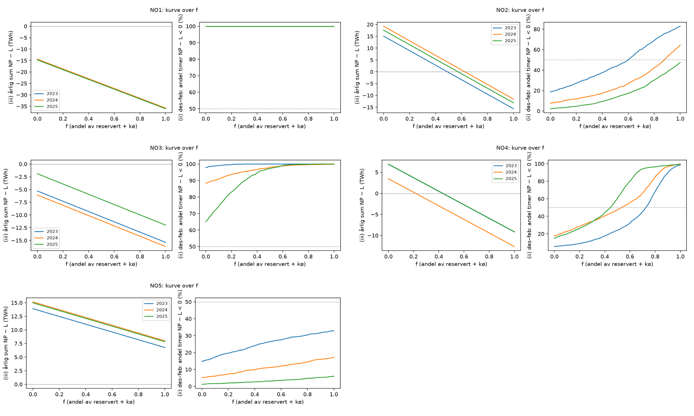

**Sammendrag.** Vi bruker ENTSO-E-data for produksjon (A75) og last (A65) per time i de fem norske budområdene for
2023, 2024 og 2025. På de observerte timene legger vi flat last tilsvarende datasenterkapasiteten som Statnett per
2. november 2026 har reservert eller satt i kø. Vi rapporterer hvor ofte, hvor mye og hvor dypt produksjonen ligger
under lasten. Analysen er preregistrert (signert git-tagg `prereg-v1`) og deterministisk, og den er ikke en prognose.
Uten påslag lå produksjonen under lasten i 76–99 % av timene i NO1 og i 65–88 % i NO3. NO2, NO4 og NO5 hadde
overskudd på årsbasis alle tre år. Med en tredjedel av reservert og køsatt datasenterkapasitet (S3) stiger andelen
timer med produksjon under last i NO4 fra 18,3 / 36,4 / 7,6 % til 34,5 / 60,0 / 30,1 % (2023 / 2024 / 2025).
Netto import er ikke mangel eller rasjonering; tolkningsreglene i avsnitt 6 gjelder alle tall.

# 1 Bakgrunn

NVEs scenarioanalyse for 2026 legger 3,6 GW reservert datasenterkapasitet til grunn i sitt høyeste
datasenterscenario og skriver at «I denne analysen har vi ikke gjort egne analyser av hvordan endrede
utviklingsbaner for forbruk og produksjon mot 2035 vil kunne påvirke utviklingen i effektbalanse», og at «Særlig
gjelder dette datasentre, der vi har antatt en jevn forbruksprofil over året» (NVE Rapport 37/2026, s. 17 og 27).
NVE oppgir samtidig om lag 4 GW reservert og om lag 9 GW i kø for datasentre (s. 27). NVEs analyse modellerer
framtiden over 30 værår, med kraftbalanse og priser også per budområde (s. 16–20).

De Facto-rapport 4:2025 (Lekve, 7. august 2025, utført på oppdrag for Rødt) viser kraftbalanse per prisområde for
2021–2025 fra Elhub-data, med månedsoppløsning. Rapporten viser figurer, og vi fant ikke data eller kode publisert
sammen med den. Riksrevisjonen fant at «Det
finnes ikke aggregert informasjon om den faktiske utnyttelsen av nettet» (Dokument 3:7 (2024–2025), rapporten s. 52), og at
det per september 2024 var reservert i overkant av 8 400 MW til forbrukskunder (s. 10–11).

Vi fant ikke noe åpent, etterprøvbart arbeid som i ettertid, time for time og per budområde, legger Statnetts
reservasjons- og køtall på observerte timer (kildegjennomgang i `truth/SOURCES`). Dette notatet gjør det og stopper
der. Vi modellerer ikke priser, nett inne i sonene, respons i produksjon eller import, eller effektbalanse.

# 2 Data

- **Produksjon:** ENTSO-E A75 (aggregert produksjon per type), sum over alle typer. Forbruksserier i A75 (B10 i
  NO2, NO3 og NO5 og B18 i NO2, bare i 2025) er utelatt.
- **Last:** ENTSO-E A65 faktisk totallast. Etter forordning (EU) 543/2013 art. 2 nr. 27 inkluderer «total load»
  nettap og ekskluderer kraft brukt til energilagring.
- **Fysisk flyt:** ENTSO-E A11 over de 15 grensene som berører NO1–NO5, begge retninger (kontroll).
- Rå XML (ENTSO-E Transparency Platform) er parset med «hold forrige verdi» (A03) og aggregert til varighetsvektet
  timemiddel i UTC. Alle 120 serie-år har 8 760 / 8 784 / 8 760 gyldige timer.
- **Datasenterkapasitet:** Statnett, «Statistikk om tilknytningssaker», forbruk, næringstype Datasenter, avlest
  2. november 2026 (arkivert med skjermbilder, sha256 og OpenTimestamps). R = reservert, Q = kapasitetskø.
- **Eksisterende datasenterlast:** Elhub `consumption_datacenter_per_mba_hour` (CC BY 4.0), per prisområde.
  E_y = gjennomsnittlig MW i år y; E_ref = E_2025.
- **Datatilgang:** A75- og A65-seriene distribueres ikke, fordi de ikke står på ENTSO-Es liste over åpne data
  (18.10.2023). Med egen ENTSO-E-token kan de bygges byte-likt med `rebuild_data_KHEPRI-DC_v1.py`.

# 3 Metode

NP_t = produksjon_t − last_t (MW). Påslaget er flat last i år y og scenario s:
L = (E_ref − E_y) + 0,70 × (w × R_new + q × Q), der R_new = max(0, R − E_ref / 0,70) og 0,70 er NVEs brukstid.
Scenariene er S0 observert (L = 0), S1 (w = 0,25, q = 0), S2 (1, 0), S3 (1/3, 1/3) og S4 (1, 1). S4 er en øvre
grense og kan telle samme kapasitet to ganger, fordi prosjekter med reservasjon på særlige vilkår også står i kø.
Kurven setter w = q = f for f = 0,00–1,00. Utfall per sone og år: (i) andel timer med NP − L < 0, (ii) samme for
desember–februar, (iii) årlig sum av NP − L (TWh), (iv) laveste timeverdi (MW), og endring mot S0. Kontrollen
sammenligner NP med netto fysisk flyt ut av sonen (A11), med preregistrert grense MAE / middel |NP| ≤ 0,05.

Tabell 1 viser kapasitet og påslag (MW, 2025; for 2023 og 2024 kommer løftet E_ref − E_y i tillegg).

| Sone | R | Q | E_ref | R_new | L S1 | L S2 | L S3 | L S4 |
|---|---|---|---|---|---|---|---|---|
| NO1 | 1398 | 2220 | 97 | 1259 | 220 | 882 | 812 | 2436 |
| NO2 | 1950 | 3092 | 27 | 1912 | 335 | 1338 | 1168 | 3503 |
| NO3 | 96 | 1646 | 154 | 0 | 0 | 0 | 384 | 1152 |
| NO4 | 477 | 2258 | 81 | 361 | 63 | 253 | 611 | 1833 |
| NO5 | 270 | 894 | 0 | 270 | 47 | 189 | 272 | 815 |

# 4 Resultater

**Observert (S0).** Tabell 2 viser andel timer, sum og laveste verdi av NP uten påslag (2023 / 2024 / 2025).

| Sone | (i) andel timer NP < 0 (%) 2023 / 2024 / 2025 | (ii) des–feb (%) | (iii) sum NP (TWh) | (iv) laveste NP (MW) |
|---|---|---|---|---|
| NO1 | 76,3 / 83,2 / 99,0 | 100,0 / 100,0 / 100,0 | −13,7 / −13,9 / −14,7 | −5268 / −5792 / −5104 |
| NO2 | 16,1 / 10,8 / 16,5 | 18,4 / 7,6 / 2,2 | 15,2 / 19,3 / 17,6 | −3265 / −2399 / −2641 |
| NO3 | 81,2 / 88,3 / 65,1 | 95,7 / 86,6 / 65,1 | −4,5 / −5,5 / −1,9 | −2398 / −2651 / −2097 |
| NO4 | 18,3 / 36,4 / 7,6 | 5,3 / 17,4 / 15,0 | 7,0 / 3,6 / 6,9 | −1126 / −1111 / −916 |
| NO5 | 13,0 / 7,5 / 4,9 | 14,8 / 5,3 / 1,2 | 13,9 / 15,1 / 15,0 | −1142 / −863 / −756 |

**S3: en tredjedel av reservert og køsatt kapasitet.** Tabell 3 (2023 / 2024 / 2025).

| Sone | (i) andel timer NP − L < 0 (%) | Δ(i) mot S0 (pp) | (ii) des–feb (%) | (iii) sum (TWh) | (iv) laveste (MW) |
|---|---|---|---|---|---|
| NO1 | 98,3 / 99,3 / 100,0 | 22,0 / 16,1 / 1,0 | 100,0 / 100,0 / 100,0 | −21,6 / −21,5 / −21,8 | −6161 / −6660 / −5916 |
| NO2 | 33,6 / 23,2 / 28,8 | 17,6 / 12,5 / 12,3 | 33,8 / 15,2 / 7,1 | 4,8 / 9,0 / 7,3 | −4448 / −3576 / −3809 |
| NO3 | 95,2 / 97,1 / 89,2 | 14,0 / 8,8 / 24,1 | 100,0 / 95,7 / 91,6 | −8,7 / −9,5 / −5,3 | −2875 / −3095 / −2481 |
| NO4 | 34,5 / 60,0 / 30,1 | 16,2 / 23,6 / 22,5 | 14,0 / 36,0 / 37,2 | 1,5 / −1,9 / 1,6 | −1753 / −1732 / −1528 |
| NO5 | 18,0 / 11,2 / 9,5 | 5,1 / 3,7 / 4,6 | 22,3 / 9,3 / 2,5 | 11,5 / 12,8 / 12,6 | −1411 / −1134 / −1028 |

**S4: all reservert og køsatt kapasitet (øvre grense).** Tabell 4 (2023 / 2024 / 2025).

| Sone | (i) andel timer NP − L < 0 (%) | Δ(i) mot S0 (pp) | (ii) des–feb (%) | (iii) sum (TWh) | (iv) laveste (MW) |
|---|---|---|---|---|---|
| NO1 | 100,0 / 100,0 / 100,0 | 23,7 / 16,8 / 1,0 | 100,0 / 100,0 / 100,0 | −35,8 / −35,8 / −36,1 | −7785 / −8284 / −7540 |
| NO2 | 88,9 / 83,3 / 78,9 | 72,9 / 72,5 / 62,4 | 82,9 / 64,5 / 47,4 | −15,6 / −11,5 / −13,1 | −6783 / −5911 / −6144 |
| NO3 | 100,0 / 99,9 / 99,7 | 18,8 / 11,7 / 34,6 | 100,0 / 99,8 / 100,0 | −15,4 / −16,2 / −12,0 | −3644 / −3863 / −3249 |
| NO4 | 99,2 / 99,6 / 99,6 | 81,0 / 63,2 / 92,0 | 98,7 / 99,5 / 99,3 | −9,2 / −12,6 / −9,1 | −2975 / −2954 / −2750 |
| NO5 | 28,0 / 20,7 / 21,3 | 15,1 / 13,2 / 16,4 | 32,9 / 17,2 / 6,0 | 6,8 / 8,0 / 7,8 | −1954 / −1677 / −1571 |

S1 og S2 står i `results/scenarier.csv`. I NO3 er R (96 MW) mindre enn E_ref / 0,70, så R_new = 0 og S1 = S2.
Summen av de fem sonenes (iii) er 17,9 / 18,6 / 22,9 TWh observert, −12,3 / −11,1 / −5,6 TWh i S3 og
−69,2 / −68,1 / −62,5 TWh i S4. Disse summene er aritmetikk på de preregistrerte sonetallene, ikke egne
preregistrerte utfall.

**Kurve.** Tabell 5 viser minste f der årssummen blir ≤ 0, og minste f der over halvparten av vintertimene har
NP − L < 0. Det andre punktet er bare et rapporteringspunkt, ikke en terskel for noe annet.

| Sone | minste f der (iii) ≤ 0: 2023 / 2024 / 2025 | minste f der (ii) > 50 %: 2023 / 2024 / 2025 |
|---|---|---|
| NO1 | 0,00 / 0,00 / 0,00 | 0,00 / 0,00 / 0,00 |
| NO2 | 0,50 / 0,63 / 0,58 | 0,60 / 0,88 / ikke nådd |
| NO3 | 0,00 / 0,00 / 0,00 | 0,00 / 0,00 / 0,00 |
| NO4 | 0,43 / 0,22 / 0,44 | 0,73 / 0,54 / 0,45 |
| NO5 | ikke nådd / ikke nådd / ikke nådd | ikke nådd / ikke nådd / ikke nådd |

{width=100%}

**Kontroll.** Tabell 6. NP fra A75 − A65 følger netto fysisk flyt tett (r ≥ 0,985), men avviket er over den
preregistrerte grensen i NO2, NO3 og NO4 alle tre år (6–14 % av middel |NP|). Avviket er ført som avvik og ikke
justert. Årsaken er undersøkt utforskende i avsnitt 5.

| Sone | MAE / middel abs NP: 2023 / 2024 / 2025 | r: 2023 / 2024 / 2025 | Innenfor 0,05 |
|---|---|---|---|
| NO1 | 0,032 / 0,036 / 0,015 | 0,999 / 1,000 / 0,998 | ja |
| NO2 | 0,112 / 0,072 / 0,061 | 0,991 / 0,995 / 0,994 | nei |
| NO3 | 0,136 / 0,113 / 0,113 | 0,987 / 0,985 / 0,988 | nei |
| NO4 | 0,089 / 0,103 / 0,056 | 0,989 / 0,992 / 0,990 | nei |
| NO5 | 0,042 / 0,044 / 0,028 | 0,996 / 0,995 / 0,997 | ja |

# 5 Begrensninger

Tolkningsreglene under er preregistrert og gjelder alle tall. I tillegg kommer tre forhold. Elhubs datasenterutvalg
er målepunkt med næringskodene 63.100 og 63.110 (SN2025) og kan både over- og underdekke datasentre. Statnetts tall er en Power BI-visning
uten historikk. Kontrollen viser at A75 − A65 avviker fra netto fysisk flyt i tre av fem soner.

*Utforskende, ikke preregistrert (truth/DIAGNOSE_DEV1).* Avviket har en retning. I NO2 og NO5 ligger A75 − A65 over
netto fysisk flyt med 0,9–1,8 og 0,2–0,4 TWh per år. Det er forenlig med pumpeforbruk, som A65 utelater etter
definisjonen. I NO1, NO3 og NO4 ligger det under med 0,1–0,5 TWh per år, forenlig med at A75 ligger under Elhubs
produksjonstall. Hovedmålet viser dermed trolig for få timer under null i NO2 og NO5 og for mange i NO1, NO3 og NO4.
Tabell 7 viser hovedtallene regnet på nytt med NP fra A11 (hovedmål / A11).

| Sone | År | (i) S0 (%) | (i) S3 (%) | (iii) S3 (TWh) | minste f, (iii) ≤ 0 |
|---|---|---|---|---|---|
| NO1 | 2023 | 76,3 / 75,1 | 98,3 / 98,0 | −21,6 / −21,2 | 0,00 / 0,00 |
| NO1 | 2024 | 83,2 / 81,5 | 99,3 / 99,0 | −21,5 / −21,0 | 0,00 / 0,00 |
| NO1 | 2025 | 99,0 / 99,0 | 100,0 / 100,0 | −21,8 / −21,8 | 0,00 / 0,00 |
| NO2 | 2023 | 16,1 / 20,2 | 33,6 / 36,7 | 4,8 / 3,1 | 0,50 / 0,44 |
| NO2 | 2024 | 10,8 / 12,4 | 23,2 / 25,3 | 9,0 / 7,6 | 0,63 / 0,59 |
| NO2 | 2025 | 16,5 / 18,1 | 28,8 / 29,6 | 7,3 / 6,5 | 0,58 / 0,55 |
| NO3 | 2023 | 81,2 / 77,4 | 95,2 / 94,6 | −8,7 / −8,1 | 0,00 / 0,00 |
| NO3 | 2024 | 88,3 / 86,9 | 97,1 / 96,9 | −9,5 / −9,0 | 0,00 / 0,00 |
| NO3 | 2025 | 65,1 / 62,1 | 89,2 / 87,7 | −5,3 / −5,0 | 0,00 / 0,00 |
| NO4 | 2023 | 18,3 / 16,4 | 34,5 / 33,3 | 1,5 / 1,9 | 0,43 / 0,46 |
| NO4 | 2024 | 36,4 / 35,2 | 60,0 / 59,4 | −1,9 / −1,7 | 0,22 / 0,23 |
| NO4 | 2025 | 7,6 / 6,8 | 30,1 / 27,7 | 1,6 / 1,9 | 0,44 / 0,45 |
| NO5 | 2023 | 13,0 / 14,1 | 18,0 / 19,2 | 11,5 / 11,2 | ikke nådd / ikke nådd |
| NO5 | 2024 | 7,5 / 8,4 | 11,2 / 12,3 | 12,8 / 12,3 | ikke nådd / ikke nådd |
| NO5 | 2025 | 4,9 / 6,1 | 9,5 / 10,6 | 12,6 / 12,4 | ikke nådd / ikke nådd |

# 6 Tolkningsregler (ordrett fra PREREG)

1. Netto import er ikke mangel eller rasjonering.
2. Vannkraft og import er normal drift.
3. Naboområdenes last holdes uendret.
4. Ingen kapasitet på enkeltlinjer inne i sonen er modellert (Svartisen-stoppen gjelder ikke hele NO4).
5. Kø og reservasjoner er et øyeblikksbilde fra 2026 lagt på observerte timer fra 2023–2025.
6. Tre observerte år, ikke 30 værår.
7. 2025 rapporteres for seg: det var et år med rekordhøy produksjon (161 TWh) og rekordhøyt kraftoverskudd
   (23 TWh), mot om lag 15 TWh i et normalår (NVE Rapport 17/2026, s. 2).

# 7 Konklusjon

I de observerte timene 2023–2025 hadde NO1 og NO3 produksjon under last i de fleste timene, mens NO2, NO4 og NO5
hadde overskudd på årsbasis. Når Statnetts reserverte og køsatte datasenterkapasitet legges på som flat last, skifter
årssummen fortegn i NO4 ved f = 0,43 / 0,22 / 0,44 og i NO2 ved f = 0,50 / 0,63 / 0,58. I NO5 skjer det ikke for
noen f. Tallene beskriver observerte timer med et påslag. De sier ikke hva som vil skje, og de er ikke en anbefaling
for eller mot datasentre.

**Data og kode:** https://doi.org/10.5281/zenodo.23887356. Kode Apache-2.0, data CC BY 4.0. Kilder: ENTSO-E Transparency Platform; Elhub
(CC BY 4.0); Statnett. **KI-bruk:** analysen er utført med Claude Code som verktøy under forfatterens styring
(AIUSE.md).
